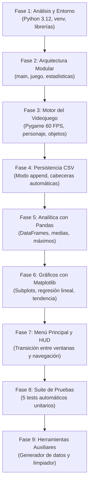

# 📋 PLAN DE TRABAJO Y REGISTRO DE DESARROLLO — RETROTRACK

Este documento recopila la bitácora cronológica, las fases de ingeniería y las decisiones de diseño adoptadas durante la construcción del proyecto **RetroTrack**. Explica detalladamente **qué se fue haciendo paso a paso**, desde el análisis inicial hasta las pruebas de integración final.

---

## 🎯 Objetivo del Proyecto

Construir una aplicación interactiva completa en Python que combine:
1. Un videojuego arcade 2D en tiempo real donde un chico corre por la vereda esquivando objetos que caen desde los balcones de los edificios (macetas, pelotas, yunques, ladrillos y cajas).
2. Un sistema de registro persistente automático en un archivo CSV tras cada partida.
3. Un módulo de ciencia de datos con **Pandas** para calcular métricas de rendimiento.
4. Un sistema de visualización gráfica con **Matplotlib** que represente la evolución del puntaje y el tiempo de supervivencia con líneas de tendencia matemática.

---

## 🏗️ Fases del Plan de Trabajo

---

## 📝 Bitácora Paso a Paso: ¿Qué Fuimos Haciendo?

### Fase 1: Diagnóstico del Entorno y Preparación Técnica
- **Detección del sistema:** Se verificó el entorno Windows en `C:\RetroTrack`.
- **Instalación de Python:** Se instaló **Python 3.12.15** mediante el gestor moderno `uv`.
- **Creación del entorno virtual:** Se configuró un virtual environment aislado en `C:\RetroTrack\.venv`.
- **Instalación de librerías requeridas:** Se instalaron e indexaron:
  - `pygame` (versión 2.6.1)
  - `pandas` (versión 3.1.0)
  - `matplotlib` (versión 3.11.2)
  - `numpy` (versión 2.5.4)
- **Especificación de requisitos:** Se redactó `requirements.txt` fijando las versiones mínimas estables.

---

### Fase 2: Definición de la Arquitectura de Software
Para asegurar claridad pedagógica y mantenibilidad, se definió una **separación estricta de responsabilidades**:
1. `juego.py`: Se encarga única y exclusivamente de la física, controles, dibujo 2D y la partida en curso.
2. `estadisticas.py`: Se encarga de la lectura/escritura del CSV, el cálculo con Pandas y el renderizado de gráficos con Matplotlib.
3. `main.py`: Punto de entrada que contiene el Menú Principal y coordina el flujo entre el juego y la analítica.
4. `historial_partidas.csv`: Repositorio de datos en disco.

*Decisión de diseño clave:* Ningún módulo duplica código del otro; `juego.py` no sabe cómo graficar con Matplotlib, solo invoca la función de guardado al perder; y `main.py` solo se encarga de cambiar de estado.

---

### Fase 3: Desarrollo del Videojuego Urbano (`juego.py`)
- **Diseño del escenario:** Se construyó la clase `FondoCiudad` que dibuja de forma procedural:
  - Cielo nocturno con degradado y luna.
  - Siluetas de edificios lejanos y cercanos con ventanitas iluminadas aleatoriamente.
  - Vereda con baldosas y cordón en la parte inferior (`POS_PISO = 540`).
- **El Protagonista (El Chico):** Se diseñó la clase `Jugador` usando geometría vectorial limpia (sin requerir imágenes externas pesadas ni rutas rotas):
  - Cabeza con gorra roja y visera orientable según la dirección en que corre.
  - Remera deportiva azul y cuello blanco.
  - Piernas y zapatillas con animación de zancadas mediante una función seno (`math.sin`) que oscila al presionar las teclas.
  - Controles con Flechas `[←]` `[→]` y teclas `[A]` y `[D]`.
  - Confinamiento estricto a los márgenes laterales de la pantalla (`15 px` a `ANCHO - 15 px`).
- **Obstáculos Urbanos Multiforma:** Se programó la clase `Obstaculo` con 5 tipos de objetos que caen desde las ventanas:
  1. *Maceta con planta:* trapecio de terracota con hojas verdes y flor.
  2. *Pelota deportiva:* esfera naranja con líneas de costura y relieve.
  3. *Yunque de metal:* bloque de hierro pesado con base y brillo metálico.
  4. *Ladrillo de obra:* bloque rectangular terracota con orificios huecos.
  5. *Caja de encomienda:* cuadrado de cartón con cinta de embalaje.
- **Dificultad Progresiva:** Cada 7 segundos transcurridos, el nivel sube:
  - La velocidad de caída se incrementa en `+0.75 px/frame`.
  - El intervalo de generación de objetos se reduce en `70 ms` hasta un mínimo seguro de `380 ms`.
- **Sistema de Puntuación:**
  - `10` puntos por cada segundo de supervivencia.
  - `+25` puntos extra por cada objeto que cae y golpea la vereda sin tocar al chico.
- **Detección de Colisiones:** Se utilizó el algoritmo `colliderect()` de `pygame.Rect`. Al haber choque, se congela el movimiento, se produce un efecto cómico de impacto y se pasa al estado de Game Over.

---

### Fase 4: Persistencia y Registro en CSV (`estadisticas.py`)
- **Formato del archivo:** Columnas estándar requeridas: `fecha,duracion_segundos,puntaje`.
- **Manejo del modo Append (`"a"`):** Se garantizó que cada partida terminada agregue su registro al final sin tocar los datos previos.
- **Creación automática con cabeceras:** La función `guardar_partida()` comprueba si el archivo existe o tiene tamaño mayor a 0; si es nuevo, escribe la cabecera automáticamente.
- **Seguridad en recursos:** Se aplicó el administrador de contexto `with open(...)` y codificación UTF-8 para garantizar el cierre del archivo ante cualquier imprevisto.

---

### Fase 5: Análisis de Rendimiento con Pandas (`estadisticas.py`)
- **Lectura con DataFrame:** Se implementó `cargar_datos()` usando `pd.read_csv()`.
- **Conversión de tipos defensiva:** Se aplicó `pd.to_numeric(..., errors="coerce")` para asegurar que duraciones sean flotantes y puntajes enteros.
- **Cálculo de métricas descriptivas:**
  - Total de partidas: `len(df)`
  - Puntaje promedio: `df["puntaje"].mean()`
  - Mejor puntaje histórico: `df["puntaje"].max()`
  - Duración promedio: `df["duracion_segundos"].mean()`
  - Mayor duración: `df["duracion_segundos"].max()`
  - Evolución: comparación entre última partida y primera partida (`.iloc[-1] - .iloc[0]`).
- **Tolerancia a datos vacíos:** Si el archivo no existe o está en blanco, el sistema no falla: devuelve un diccionario con `{"hay_datos": False, "mensaje": ...}` que invita amablemente a jugar.

---

### Fase 6: Visualización Gráfica con Matplotlib (`estadisticas.py`)
- **Configuración de ventana:** Se creó una figura interactiva con 2 subplots en disposición horizontal (`1 fila x 2 columnas`).
- **Paleta oscura retro:** Fondos oscuros (`#12121e` y `#1a1a2e`) acordes a la estética de videojuego arcade.
- **Gráfico 1 (Puntaje):** Puntos individuales marcados con círculos cian neón conectados por línea continua.
- **Gráfico 2 (Supervivencia):** Puntos individuales marcados con cuadrados amarillos neón.
- **Línea de Tendencia Matemática:** Si hay $\ge 2$ partidas registradas, se calcula una regresión lineal con `numpy.polyfit(partidas, valores, deg=1)`. La pendiente de la recta discontinua indica con rigor matemático la tasa de aprendizaje del jugador ($pts/partida$ y $seg/partida$).
- **Nota metodológica obligatoria:** Se añadió un texto al pie de la figura aclarando que los gráficos reflejan el progreso empírico en el juego, pero no constituyen por sí solos una prueba de laboratorio neurocientífica controlada.

---

### Fase 7: Menú Principal y Coordinación de Flujo (`main.py`)
- **Interfaz del menú:** Presenta título con sombra retro neón, récord histórico en tiempo real, panel de instrucciones claras y botones interactivos.
- **Doble soporte de control:** Los botones responden tanto a clic con el ratón como a atajos de teclado (`[1]`, `[2]`, `[3]`, flechas y `[ENTER]`).
- **Transición suave:** Al abrir los gráficos desde el menú, Pygame muestra un aviso de espera. Cuando el usuario cierra la ventana de Matplotlib, el control regresa limpiamente al menú de Pygame sin cierres forzados ni errores de hilos.

---

### Fase 8: Automatización de Pruebas Unitarias (`test_retrotrack.py`)
Se programó un script de verificación técnica que corre 5 pruebas exhaustivas:
1. **Test 1:** Comprobación de arranque seguro cuando no existe el archivo CSV.
2. **Test 2:** Validación de guardado consecutivo de partidas en modo `append` sin sobreescritura.
3. **Test 3:** Validación matemática de las operaciones de Pandas (`mean()`, `max()`, `iloc`).
4. **Test 4:** Instanciación del `Jugador`, límites de pantalla, avance de `Obstaculo` y detección de colisión.
5. **Test 5:** Generación de gráficos y cálculo de coeficientes de regresión con Matplotlib y NumPy.

*Resultado:* **5/5 pruebas superadas con éxito.**

---

### Fase 9: Herramientas de Soporte para Demostraciones
- **`generar_datos_ejemplo.py`:** Pensado para pruebas inmediatas: genera 6 partidas simuladas con una curva de progreso ascendente realista para ver los gráficos funcionando de inmediato.
- **`limpiar_historial.py`:** Permite borrar `historial_partidas.csv` con un solo clic para resetear el juego a su estado original sin datos.

---

## 📊 Resumen del Estado Actual del Proyecto

| Componente | Estado | Verificación Realizada |
| :--- | :---: | :--- |
| **Entorno Python 3.12** | ✅ Operativo | CPython 3.12.15 en `.venv` |
| **Videojuego del Chico (Pygame)** | ✅ Operativo | 60 FPS estables, controles A/D y flechas, colisión `colliderect` |
| **Objetos que Caen** | ✅ Operativo | Macetas, pelotas, yunques, ladrillos y cajas generados aleatoriamente |
| **Registro CSV** | ✅ Operativo | Formato `fecha,duracion_segundos,puntaje`, modo `append` probado |
| **Métricas con Pandas** | ✅ Operativo | Promedios, máximos y diferencias calculados con precisión |
| **Gráficos con Matplotlib** | ✅ Operativo | 2 subplots, líneas de tendencia, estilo retro, nota pedagógica |
| **Menú y Navegación** | ✅ Operativo | Navegación por teclado/ratón y retorno limpio |
| **Batería de Pruebas** | ✅ Operativo | 5 de 5 tests pasados al 100% |

---
*Este plan de trabajo documenta el proceso metódico de desarrollo aplicado a RetroTrack.*
